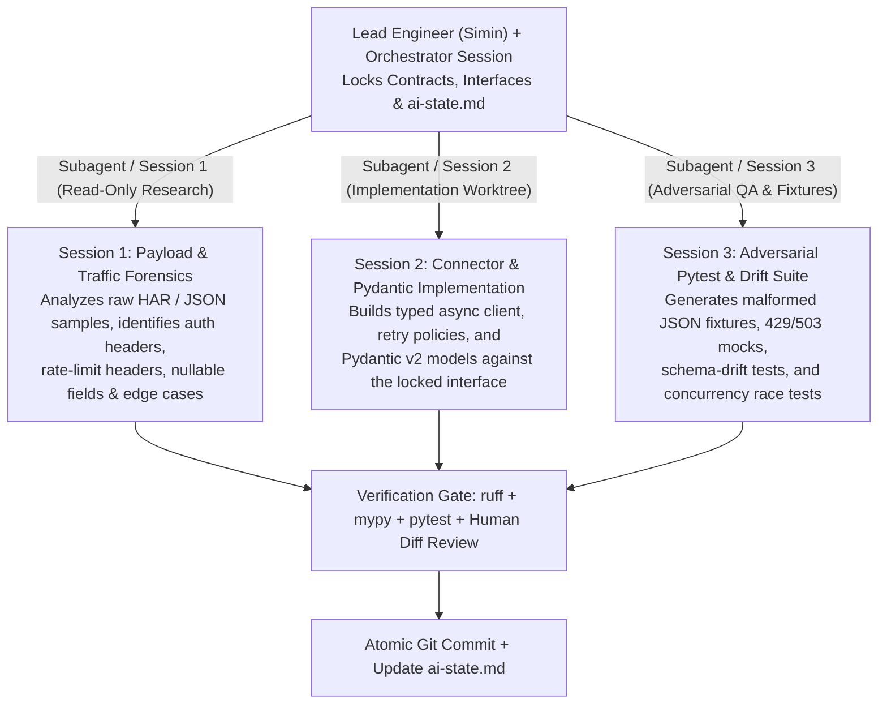

# Laptop Setup & Agentic Workflow Showcase Script (First 15 Minutes of Interview 1)

> **What Luis Wrote in the Email:**  
> *"1. 45-60' conversational interview: We will ask you to fire up your laptop, show us your setup and complete a brief task with AI. We will talk about it for a bit and then we will chat about some concepts (cheat sheet below)."*  
> *"And of course how do you work with AI: how do you use agents, skills, plugins... How do you use sessions in parallel, and so on."*

---

## 1. Pre-Interview Laptop Readiness Checklist (Before 12:45h on Friday)

Before walking into Ruit's office at Lanzadera, make sure your laptop is in "Clean Cockpit Mode":
- [ ] **Battery at 100%** + charger accessible in your bag; Wi-Fi + phone hotspot ready as instant backup.
- [ ] **Do Not Disturb ON** (hide personal notifications, email popups, WhatsApp/Telegram).
- [ ] **Terminal & IDE Ready:**
  - Open **Antigravity / VS Code** with a clean workspace specifically prepared for the live task (e.g., `interview-preparation/01-ai-workflow-and-live-task/live-task-sandbox/`).
  - Have a Python 3.11+ virtual environment activated with `pytest`, `pydantic`, `httpx`, `ruff`, and `mypy` already installed (`pip install pydantic httpx pytest pytest-asyncio ruff mypy`) so you waste **zero seconds** waiting for pip downloads on office Wi-Fi!
- [ ] **Demonstrable Customizations Open in Tabs:**
  - Keep a tab or quick reference ready showing:
    1. Your **Project Context & State file pattern** (`ai-state.md` / `CONTEXT.md`).
    2. A reusable **Skill (`SKILL.md`)** for API Integration & Pydantic Schema Generation.
    3. Your **Git log** showing clean, atomic commits after each agent step.

---

## 2. The 3-Minute "Show Us Your Setup" Walkthrough Script

When Luis says, *"Fire up your laptop and show us how you work with AI,"* don't just open an empty chat box. Walk him through your **4-Layer Agentic Engineering System**:

### Layer 1: Persistent State & Context Architecture (`ai-state.md` + `master-prompt.md`)
- **What to show:** Show how you structure every repository with a dedicated context/control plane (`ai-state.md` and `master-prompt.md`).
- **What to say:**
  > *"The biggest failure mode when working with AI agents on complex backends is context drift across sessions. Before I let an agent write a single line of code, I establish a persistent `ai-state.md` file that holds the architectural invariants, current progress tracker, and strict rules—like running tests and making an atomic Git commit after every step. Whenever I start a new session or spawn a subagent, it reads `ai-state.md` first and updates it when done."*

### Layer 2: Skills (`SKILL.md`), Rules, and Plugins / MCPs
- **What to show:** Point to how you use modular **Skills** (`SKILL.md`), workspace **Rules**, and **MCP servers/plugins**.
- **What to say:**
  > *"Instead of repeating long prompts, I package repeatable engineering workflows into **Skills (`SKILL.md`)** and workspace rules:*
  > 1. ***Rules:*** *Enforce non-negotiable standards automatically—strict Python type hints, Pydantic v2 at every external boundary, `ruff` + `mypy` validation, and never swallowing exceptions.*
  > 2. ***Skills (`SKILL.md`):*** *Domain-specific playbooks that load on demand. For example, for marketplace integrations, a skill defines our exact pattern for inspecting a raw network payload/HAR file, generating a strict Pydantic v2 model + a schema-drift detector, wrapping `httpx.AsyncClient` with exponential backoff + jitter, and writing `pytest` fixtures.*
  > 3. ***Plugins & MCPs:*** *Connect the agent directly to documentation, browser inspection (DevTools/Playwright), database schemas, and test runners so the agent verifies its own work in a closed loop."*

### Layer 3: Running Agent Sessions in Parallel (Your Multiplier)
Luis specifically asked: ***"How do you use sessions in parallel, and so on."***  
Here is the exact mental model and practical workflow to explain and demonstrate:



- **How to explain your parallel session strategy clearly:**
  1. **Contract-First Decomposition:** *"You can't parallelize two agents editing the exact same file blindly—they'll create merge conflicts or incompatible assumptions. So first, I spend 2 minutes locking the **data contract** (e.g., Python `Protocol` interface + Pydantic models in `schemas.py`)."*
  2. **Parallel Subagents / Parallel Sessions (or Git Worktrees):**
     - **Session A (Research / Reverse-Engineering Agent):** Analyzes raw network captures (HAR files, undocumented API responses), extracts edge cases, weird date/price formats, and auth header requirements without cluttering the main coding context window.
     - **Session B (Implementation Agent):** Writes the async `httpx` client, retry logic, and adapter implementation.
     - **Session C (Adversarial Test Agent):** Writes `pytest` tests simulating broken upstream schemas, `429 Too Many Requests` with `Retry-After`, partial network timeouts, and concurrency races.
  3. **Git Worktrees for Larger Features:** *"When running two heavy write-sessions simultaneously on different features or marketplace connectors (say, Depop in one session and Vestiaire in another), I isolate them in separate **Git worktrees** (`git worktree add ../wt-depop feat/depop`) or branched subagent workspaces so their file edits and test runs never collide."*

### Layer 4: Closed-Loop Verification (Never Trust Unverified AI Output)
- **What to say:**
  > *"At QueryLaw, where we needed 95%+ legal reasoning accuracy, I learned that AI speed is useless without deterministic guardrails. Every coding prompt I run ends with an automated verification loop: `ruff check`, `mypy`, and `pytest`. And before committing, I review the diff specifically for silent failure modes—like missing HTTP timeouts, non-idempotent retries, or overly permissive `except Exception:` blocks."*

---

## 3. Reusable Skill Template You Can Show Live

During the demo, you can show this exact integration skill pattern (already embedded in our sandbox):

```markdown
---
name: marketplace-api-connector
description: Build or repair a resilient Python marketplace integration from raw HTTP/HAR traffic with Pydantic v2 validation, drift detection, and async retries.
---

# Marketplace API Connector Skill

1. **Boundary Validation First:**
   - Define Pydantic v2 `BaseModel` schemas for all external requests/responses.
   - Use `ConfigDict(extra="allow")` on inbound payloads and compare `__pydantic_extra__` against expected keys to emit structured **schema-drift warnings** before silent changes break production.
2. **Error Taxonomy:**
   - Never raise raw `httpx.HTTPError` to business logic. Map all failures into:
     - `RetryableIntegrationError` (HTTP 408, 429, 500, 502, 503, 504, network timeouts)
     - `SellerAuthExpiredError` (HTTP 401/403 token expired — trigger refresh or notify seller)
     - `UpstreamBreakageError` (HTTP 400/422/200 with Pydantic `ValidationError` — alert engineering immediately!)
3. **Resilient HTTP Client:**
   - Always reuse `httpx.AsyncClient` with explicit `httpx.Timeout(10.0, connect=3.0)`.
   - Bound concurrency with `asyncio.Semaphore`.
   - Respect `Retry-After` headers on 429s; otherwise use exponential backoff + full jitter.
4. **Verification Gate:**
   - Run `pytest`, `ruff check`, and `mypy` before committing.
```

