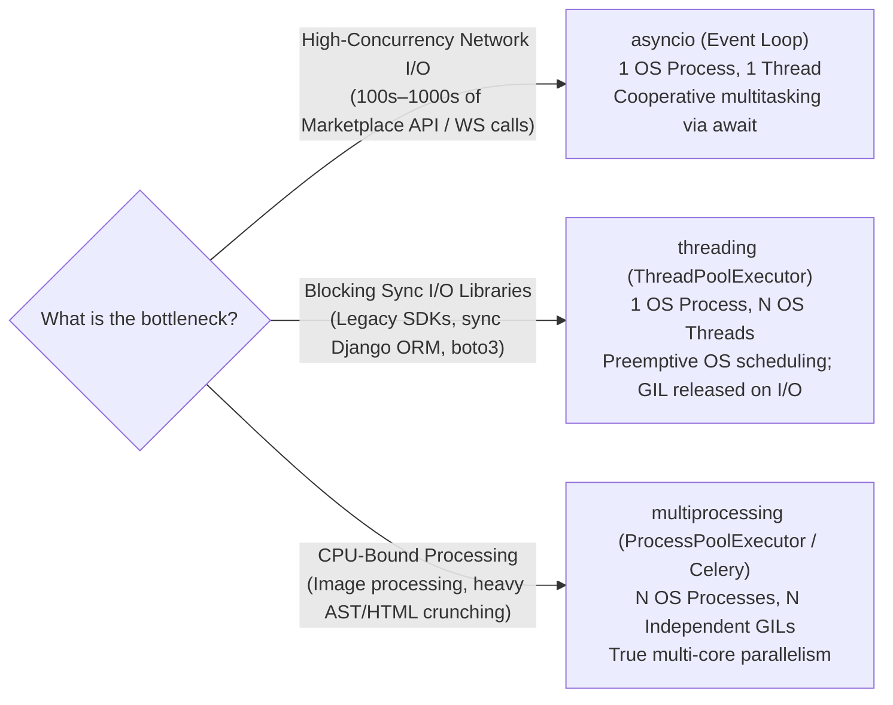

# The GIL, Concurrency & Async Python — Senior Deep Dive

> **Luis's Cheat Sheet Topic:** *"concurrency, async ... gauge the extent of your Python and Django knowledge, especially around the GIL"*

---

## 1. What Is the GIL (Global Interpreter Lock) and Why Does It Exist?

### 1.1 The Internal Mechanism in CPython
In CPython (the standard reference implementation of Python), every object in memory is represented by a C struct (`PyObject`) containing at least two fields:
1. `ob_refcnt` (`Py_ssize_t`): The **reference count** tracking how many variables/containers point to this object.
2. `ob_type`: A pointer to the object's type descriptor.

Whenever a variable references an object, CPython runs `Py_INCREF(obj)`. Whenever a reference goes out of scope, CPython runs `Py_DECREF(obj)`, and when `ob_refcnt == 0`, the memory is immediately freed.

- **Why a Global Lock Was Chosen:** If two OS threads simultaneously increment/decrement `ob_refcnt` on the same object without synchronization, a race condition occurs—causing either a memory leak or a segmentation fault (use-after-free). Putting a separate mutex lock on *every single Python object* historically added huge memory overhead and degraded single-threaded performance due to constant lock acquisition/release.
- **The Solution (The GIL):** CPython uses a single process-wide mutex around the interpreter state. **Only one OS thread can execute Python bytecode at any given instant inside a single CPython process.**

### 1.2 How CPython Switches Between Threads
1. **Cooperative Release on Blocking I/O (Crucial for Backend Engineers!):**
   - Whenever a thread performs a blocking OS system call—reading/writing a network socket (`httpx`, `requests`, PostgreSQL `psycopg`, Redis), reading/writing disk files, or calling `time.sleep()`—the C code wraps the syscall in:
     ```c
     Py_BEGIN_ALLOW_THREADS
     // Blocking OS network/disk syscall happens here WITHOUT holding the GIL!
     Py_END_ALLOW_THREADS
     ```
   - Therefore, **I/O-bound threads do NOT block each other on the GIL while waiting for network responses**.
2. **Preemptive Time-Slicing for CPU-Bound Code:**
   - Every **5 milliseconds** by default (`sys.getswitchinterval() == 0.005`), the CPython eval loop sets an atomic flag asking the currently running thread to drop the GIL at the next bytecode instruction boundary so another waiting thread can acquire it.

---

## 2. Why Multi-Threading CPU-Bound Code in Python Makes It Slower

If you run 4 threads doing pure Python CPU work (e.g., parsing large DOM trees in pure Python or computing hashes in a loop) on a 4-core CPU:
- Only **1 thread** can run bytecode at a time.
- The other 3 threads constantly wake up every 5ms, fight over the GIL mutex, trigger OS context switches, and invalidate L1/L2 CPU caches.
- **Result:** 4 CPU-bound threads in standard CPython often run **slower** than 1 single thread!

### How to Scale CPU-Bound Work in Python
1. **Use Native C/Rust Libraries that Release the GIL:**
   - Libraries like **`pydantic-core` (Rust)**, **`orjson` (Rust)**, **`lxml` (C)**, **`Pillow` (C)**, **`bcrypt`/`cryptography` (Rust/C)** execute heavy parsing/hashing in compiled machine code and release the GIL where appropriate.
2. **Use `multiprocessing` (`concurrent.futures.ProcessPoolExecutor`) or Multiple Celery Worker Processes:**
   - Spawns separate OS processes, each with its own Python interpreter, its own memory space, and **its own independent GIL**—achieving true multi-core parallelism across all CPU cores.
3. **Python 3.13 / 3.14 Free-Threaded Mode (PEP 703 — `--disable-gil`):**
   - *Senior bonus point to mention to Luis & Alonso:* Starting in Python 3.13 (experimental `python3.13t`) and maturing in 3.14, CPython introduced optional **free-threaded builds** without the GIL!
   - It replaces naive reference counting with **biased reference counting** (fast non-atomic refcounts for the owning thread, atomic refcounts for shared objects), **immortal objects** (for `None`, `True`, small ints, interned strings so they never change refcounts), and fine-grained per-object locks.

---

## 3. Comparing `asyncio` vs `threading` vs `multiprocessing`



| Dimension | `asyncio` (Coroutines) | `threading` (OS Threads) | `multiprocessing` (OS Processes) |
| :--- | :--- | :--- | :--- |
| **Scheduling** | **Cooperative** (explicit `await` points) | **Preemptive** (OS kernel + GIL 5ms switch) | **Preemptive** (OS kernel across CPU cores) |
| **Memory Overhead** | Tiny (~2 KB per coroutine task) | Medium (~8 MB stack per OS thread) | Heavy (~30–100+ MB per Python process) |
| **Max Concurrency** | **10,000+ concurrent connections** easily | ~50–500 threads before context-switch overhead hurts | ~1–2x number of CPU cores |
| **Race Conditions** | Harder to trigger accidentally, **but still possible across `await` points!** | High risk on shared mutable state (`threading.Lock` required) | Isolated memory; state shared via IPC (`Queue`, `Pipe`, Redis) |
| **Biggest Footgun** | Calling a synchronous blocking function (`time.sleep`, `requests.get`, CPU loop) freezes the **entire** event loop! | Deadlocks and race conditions on shared dicts/objects. | Serialization (`pickle`) overhead when passing large objects between processes. |

---

## 4. Production `asyncio` Patterns for Marketplace Integrations

### 4.1 Offloading Blocking Sync/CPU Work from an Async Loop
If you are inside an `async def` function and must call a synchronous library or CPU-heavy function:
- **For blocking sync I/O:** Use `await asyncio.to_thread(sync_blocking_fn, arg1)` (runs in the default `ThreadPoolExecutor`).
- **For heavy CPU work:** Use `await loop.run_in_executor(process_pool, cpu_heavy_fn, arg1)`.

### 4.2 Bounded Concurrency & Backpressure (`asyncio.Semaphore`)
Never run `await asyncio.gather(*(fetch(url) for url in ten_thousand_urls))` directly—it creates 10,000 simultaneous socket requests, exhausting file descriptors (`ulimit -n`) and triggering instant `429` IP bans. Always wrap requests in `asyncio.Semaphore(N)` or use an `asyncio.Queue` worker pool.

### 4.3 Graceful Cancellation & `asyncio.TaskGroup` (Python 3.11+)
- Note that `asyncio.CancelledError` inherits from `BaseException` (not `Exception`!) since Python 3.8 so that `except Exception:` blocks do not accidentally swallow task cancellation.
- If you catch `CancelledError` to clean up a resource (like closing a Playwright tab or releasing a Redis lock), **always re-raise it** (`raise`).

---

## 5. Rapid Interview Q&A Drill

- **Q: "If Python has the GIL, why would we use `asyncio` instead of threads for calling 10 marketplaces?"**
  - **A:** *"While both threads and `asyncio` release the GIL during socket I/O, OS threads carry ~8MB stack overhead and OS kernel context-switching costs, plus preemptive scheduling makes shared state prone to race conditions at any bytecode instruction. With `asyncio`, each coroutine costs only a few kilobytes, context switching happens explicitly at `await` points in user space, and we can easily hold 5,000+ concurrent HTTP/2 or WebSocket connections in a single process—exactly like Node.js's event loop."*
- **Q: "Can you still have a race condition in single-threaded `asyncio`?"**
  - **A:** *"Yes! Single-threaded does not mean atomic across `await` boundaries. In a read-modify-write sequence like `balance = await get_balance(); await set_balance(balance - 10)`, another coroutine can run during the `await` yield point and modify the state. You still need `asyncio.Lock()` for in-process state, and Postgres `SELECT ... FOR UPDATE` or Redis locks across multiple processes/workers."*
