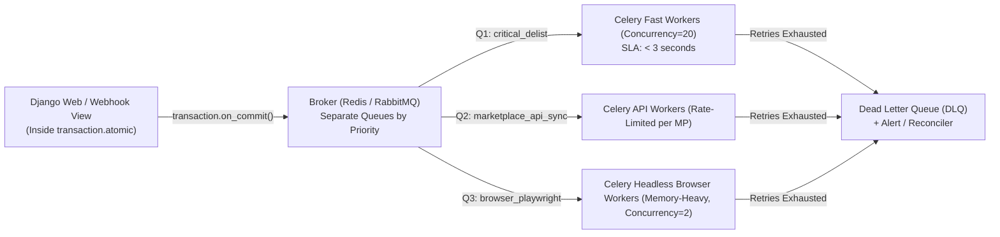

# Background Queues & Brokers: Celery, Redis & RabbitMQ

> **Luis's Cheat Sheet Topic:** *"background queues and their brokers (i.e. celery & redis)"*

---

## 1. Why Background Queues Are the Heartbeat of Ruit

When a professional seller clicks **"Publish to 6 Marketplaces"** or when an item **sells on Vinted**, Ruit cannot perform 6 external HTTP/Playwright calls synchronously inside a Django HTTP request:
1. External marketplaces are slow (500ms–10s) and flaky (`429`, `503`, timeouts).
2. A single slow marketplace would block the seller's HTTP response and tie up ASGI/WSGI workers.
3. Each marketplace has different **rate limits** and **concurrency caps**.



---

## 2. Celery Architecture & Broker Tradeoffs: Redis vs RabbitMQ

You have production experience with both **Redis** and **RabbitMQ** (from your CV). Here is how they compare specifically as **Celery brokers**:

| Dimension | Redis as Celery Broker | RabbitMQ (AMQP) as Celery Broker |
| :--- | :--- | :--- |
| **How Queues Work** | Uses Redis `LIST`s (`LPUSH` / `BRPOP`) and sorted sets (`ZSET`) for delayed/unacknowledged messages. | True message broker implementing AMQP (Exchanges $\rightarrow$ Bindings $\rightarrow$ Queues) with native consumer `ACK` / `NACK`. |
| **Operational Simplicity** | **Very high:** Already in the stack for caching & rate limiting. | Medium: Requires managing a dedicated RabbitMQ cluster. |
| **The `visibility_timeout` Trap (CRITICAL!)** | Redis does **not** have native per-connection AMQP acknowledgments. When a worker pulls a task with `acks_late=True`, Celery moves it to an `unacked` Redis hash/zset. If the task takes longer than **`visibility_timeout` (default 1 hour)**, Redis assumes the worker died and **re-delivers the same task to another worker**—causing duplicate execution! | RabbitMQ ties unacknowledged messages to the active TCP channel. As long as the worker process TCP connection stays alive (heartbeats), RabbitMQ **never** redelivers an in-flight task prematurely. |
| **Durability Guarantees** | In-memory with AOF (`appendfsync everysec`) or RDB snapshots; a hard node crash can lose ~1 second of queued tasks. | Persistent disk queues + publisher confirms provide stronger durability against broker crashes. |
| **Routing Flexibility** | Direct queue names (`-Q critical_delist,vinted_sync`). | Topic, fanout, direct, and header exchanges + native Dead Letter Exchanges (`x-dead-letter-exchange`). |

---

## 3. The 7 Production Rules for Bulletproof Celery Tasks

If Luis asks *"How do you configure Celery in production so tasks don't get lost or duplicated?"*, walk through these 7 rules:

### Rule 1: Always Enqueue Inside `transaction.on_commit()`
```python
from django.db import transaction

def update_price_and_sync(item_id: int, new_price_cents: int) -> None:
    with transaction.atomic():
        Item.objects.filter(id=item_id).update(price_cents=new_price_cents)
        # NEVER call sync_item_task.delay(item_id) directly here!
        # Redis is faster than Postgres COMMIT; the worker will wake up and read the OLD price!
        transaction.on_commit(lambda: sync_item_task.delay(item_id))
```

### Rule 2: Pass Only Primary Keys (IDs), Never ORM Objects or Large Blobs
- **Why:** Serialization (`JSON`) of large dicts bloats Redis memory, and passing a serialized object means the worker acts on **stale state** from when the task was queued rather than the fresh state in PostgreSQL when the worker executes.

### Rule 3: Understand `acks_late=True` + `task_reject_on_worker_lost=True`
- **Default Celery behavior (`acks_late=False`):** The worker acknowledges (deletes) the message from Redis **the instant it receives it**, *before* executing your function! If the container is killed (`OOM` or deploy) mid-task, the task is **lost forever**.
- **With `acks_late=True` and `task_reject_on_worker_lost=True`:** The worker only acknowledges the message *after* the task finishes.
- **The Catch:** Because `acks_late=True` means a task provides **At-Least-Once Delivery** (it *can* run twice if a worker crashes mid-flight), **every task with `acks_late=True` MUST be idempotent!**

### Rule 4: Idempotency at Both the Database and External API Levels
How do you make a Celery task idempotent so running it twice never creates 2 duplicate listings on Vinted?
1. **Database State Check + Row Lock:** Before calling the external marketplace API, lock the `MarketplaceListing` row (`select_for_update`) and check if `external_listing_id` is already populated or if `status == "DELISTED"`.
2. **Idempotency Keys / Distributed Lock:** Use a Redis lock (`SET idempotency:publish:{item_id}:{marketplace} 1 NX EX 300`) and pass an `Idempotency-Key` header if the upstream API supports it.

### Rule 5: Retries with Exponential Backoff + Full Jitter
When Wallapop returns `503 Service Unavailable`, if 500 queued tasks retry after exactly `60 seconds`, they create a synchronized **thundering herd** spike every minute. Always enable `retry_backoff=True` and `retry_jitter=True`:

```python
from celery import shared_task

@shared_task(
    bind=True,
    acks_late=True,
    reject_on_worker_lost=True,
    autoretry_for=(RetryableMarketplaceError,),
    retry_backoff=2,          # 2s, 4s, 8s, 16s...
    retry_backoff_max=300,    # Cap at 5 minutes
    retry_jitter=True,        # Randomize delay to prevent thundering herd
    max_retries=5,
)
def delist_marketplace_item_task(self, listing_id: int) -> None:
    ...
```

### Rule 6: Queue Isolation (Preventing Head-of-Line Starvation)
Never put all tasks in the single default `celery` queue! If a seller imports 50,000 items into the default queue, an urgent **"Item Sold $\rightarrow$ Delist Now"** task will sit behind 50,000 slow tasks for hours, causing double-sells!
- **`q_critical_delist`:** Dedicated fast workers; SLA < 5 seconds.
- **`q_webhooks_ingest`:** High-throughput event ingestion.
- **`q_catalog_sync`:** Bulk listing updates & price syncs.
- **`q_browser_automation`:** Isolated workers with `--concurrency=2` and `--max-tasks-per-child=50` (restarts worker process periodically to prevent Chromium memory leaks!).

### Rule 7: Hard & Soft Timeouts (`soft_time_limit` & `time_limit`)
Always set `soft_time_limit=30` and `time_limit=45` on tasks. When `soft_time_limit` fires, Celery raises `SoftTimeLimitExceeded` inside the task so your code can catch it, clean up locks/sessions, mark the sync attempt as `timed_out`, and exit cleanly before `SIGKILL` (`time_limit`) terminates the process.
