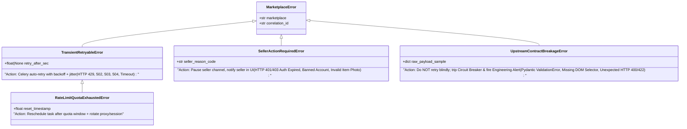

# Error Handling Philosophy: Python vs Go vs Rust (And How to Engineer Resilient Integrations)

> **Luis's Cheat Sheet Topic:** *"error handling and the philosophy behind them (python vs go vs rust for example)"*  
> **Team Context:** Founding Engineer **Alonso Veliz Garcia** specializes in **Python, Django, and Rust**. Having a crisp, deep comparison of Python vs Go vs Rust error handling—and showing how you bring Rust's explicitness into Python integrations—will strongly resonate with both Luis and Alonso.

---

## 1. The Three Philosophies Compared

| Dimension | Python (Exceptions — EAFP) | Go (Errors as Values) | Rust (Algebraic Types — `Result<T, E>`) |
| :--- | :--- | :--- | :--- |
| **Core Paradigm** | **EAFP:** *"Easier to Ask for Forgiveness than Permission."* Operations raise exceptions that unwind the call stack until caught by `try / except`. | **Explicit Return Values:** Functions return `(value, error)`. Callers inspect `if err != nil` immediately at the call site; `panic`/`recover` reserved for truly fatal bugs. | **Type-System Enforced Sum Types:** Recoverable errors return `Result<T, E>` (`Ok(T)` or `Err(E)`); absence returns `Option<T>` (`Some(T)` or `None`). Unrecoverable bugs `panic!`. |
| **Visibility in Function Signatures** | **Invisible!** Looking at `def fetch_item(id: str) -> Item:`, you have **no idea** what exceptions (`HTTPError`, `ValidationError`, `KeyError`) it might raise without reading the source code. | **Visible:** `func FetchItem(id string) (*Item, error)` tells you it can fail, though `error` is an open interface so the set of concrete error types isn't exhaustively checked by the compiler. | **Exhaustively Visible & Checked:** `fn fetch_item(id: &str) -> Result<Item, MarketplaceError>` forces the caller at compile time to handle every variant of `MarketplaceError` (or propagate explicitly via `?`). |
| **Ergonomics & Propagation** | Very clean happy path (zero boilerplate on intermediate calls), but easy to let unhandled exceptions crash a worker or accidentally swallow too much with `except Exception:`. | Very explicit local control flow, but leads to repetitive `if err != nil { return nil, fmt.Errorf("...: %w", err) }` boilerplate and you can accidentally ignore the `err` variable if not careful. | Best of both worlds: the **`?` operator** gives exception-like concise propagation while the compiler guarantees no error or `None` is ever silently ignored (`#[must_use]`). |
| **Performance Cost** | **Zero-cost try block** (since Python 3.11!), but **stack unwinding & traceback construction on raise is relatively expensive** (though cheap enough in Python that `try/except` is idiomatic for flow control like `StopIteration`). | **Constant, tiny cost:** Returning a pointer/interface value on the stack—no stack unwinding overhead when errors occur frequently. | **True Zero-Cost Abstraction:** `Result<T, E>` is just a stack-allocated tagged union (`enum`)—no heap allocation or stack unwinding on `Err`. |

---

## 2. How to Talk About Python vs Go vs Rust in the Interview

Use this nuanced, senior perspective when Luis brings this up:

> *"Python's exception model (EAFP) optimizes for readability on the happy path, which is great for high-level web views, but it has a major weakness in **integration engineering**: exceptions are invisible `goto` jumps not tracked by the type checker. When you're integrating with 10+ unreliable marketplaces, 'did this function fail because of a 429 rate limit, an expired seller cookie, or Vinted changing their JSON schema?' is the most important part of the domain logic—not an exceptional edge case.*
>
> *Go improved on this by treating errors as explicit return values (`if err != nil`), forcing you to think about failure at every network call, though Go lacks sum types so you can still forget to check `err` or miss an error case. Rust perfected it with `Result<T, E>`, `Option<T>`, and the `?` operator: failure modes are encoded directly in the return type, and the compiler forces exhaustive pattern matching (`match`) across every error variant.*
>
> *When I write Python for integrations, I bridge this gap in two ways: first, I design a **strict, closed domain exception hierarchy** mapped to operational actions (Retry vs Refresh Auth vs Alert Breakage); and second, at batch/orchestration boundaries where partial failure is normal, I return explicit **typed `Result` / `Outcome` dataclasses (Union types)** instead of raising exceptions so `mypy` forces the caller to handle both `Ok` and `Err` paths."*

---

## 3. Practical Pattern 1: Action-Oriented Exception Hierarchy in Python

In a marketplace integration engine, never let raw `httpx.HTTPError`, `json.JSONDecodeError`, or `KeyError` leak out of a connector. Map every failure at the connector boundary into **4 action-oriented categories** so Celery knows *exactly* what to do:



### Always Preserve Exception Chaining (`raise ... from exc`)
In Python, when translating a low-level error into a domain error, **always** use `raise DomainError(...) from exc` (which sets `__cause__` and keeps the original traceback attached for Sentry/logs):
```python
try:
    listing = VintedListingSchema.model_validate_json(response.content)
except ValidationError as exc:
    # Preserves the exact Pydantic field validation failure in __cause__!
    raise UpstreamContractBreakageError("vinted", "Schema drift on /items") from exc
```

---

## 4. Practical Pattern 2: Rust-Style Algebraic `Result[T, E]` in Python

When syncing 50 items or cross-listing across 5 marketplaces concurrently, failure of 1 item is **expected data**, not an unexpected crash. Using Python 3.10+ **Structural Pattern Matching (`match / case`)** + `Generic` Union types gives you Rust-like type-safe error handling verified by `mypy` / `pyright`:

```python
from dataclasses import dataclass
from typing import Generic, TypeVar, Union
from typing_extensions import assert_never

T = TypeVar("T")
E = TypeVar("E")


@dataclass(frozen=True)
class Ok(Generic[T]):
    value: T


@dataclass(frozen=True)
class Err(Generic[E]):
    error: E


Result = Union[Ok[T], Err[E]]


def handle_sync_result(res: Result[str, MarketplaceError]) -> str:
    match res:
        case Ok(value=external_id):
            return f"Published as {external_id}"
        case Err(error=TransientRetryableError(retry_after_sec=delay)):
            return f"Queued for retry (delay={delay}s)"
        case Err(error=SellerActionRequiredError(seller_reason_code=code)):
            return f"Notified seller: {code}"
        case Err(error=UpstreamContractBreakageError()):
            return "Paged engineering: marketplace contract changed!"
        case Err(error=other):
            return f"Unhandled error: {other}"
        case _ as unreachable:
            assert_never(unreachable)  # Mypy fails at compile time if a case is missed!
```
> **Note Python 3.11+ `ExceptionGroup` and `except*`:** Also mention that when using `asyncio.TaskGroup()` in Python 3.11+, if multiple concurrent tasks fail simultaneously, Python wraps them in an **`ExceptionGroup`**, which can be caught selectively by type using the **`except* TransientRetryableError as eg:`** syntax!
