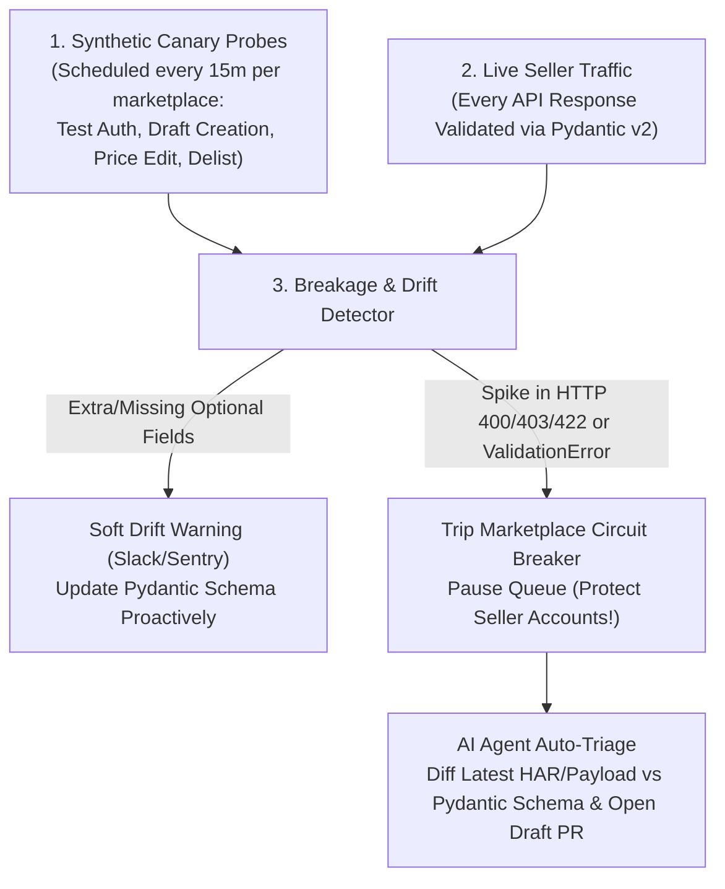

# API Integrations, Rebuilding APIs from Network Traffic & Keeping Them Alive

> **Luis's Cheat Sheet Topic:** *"api integrations and reverse engineering"*  
> **Related Job Context:** *"Integrations you kept alive after the other side changed. You can rebuild an API from an app's network traffic ... catch each breakage before a seller does."*

---

## 1. The 3 Tiers of Marketplace Integrations at Ruit

Not all marketplaces give you a clean developer portal. In the recommerce world, integrations fall into three tiers:

| Tier | Examples | Integration Mechanism | Primary Challenges |
| :--- | :--- | :--- | :--- |
| **Tier 1: Official Public APIs** | eBay, Shopify, WooCommerce, Amazon SP-API, Etsy | Documented REST/GraphQL + OAuth2 | Strict rate limits, complex OAuth token refresh lifecycles, webhook signature verification, sprawling category taxonomies. |
| **Tier 2: Undocumented Web / Mobile Private APIs** | Vinted, Wallapop, Depop, Vestiaire Collective, Grailed, Poshmark | Reverse-engineered internal JSON/GraphQL endpoints used by their SPA web app or iOS/Android app. | **JA3/TLS fingerprinting**, short-lived JWT/session cookies, CSRF tokens, device/request signing (HMAC), silent breaking schema changes. |
| **Tier 3: Browser / Chrome Extension Execution** | Marketplaces with aggressive anti-bot WAFs (DataDome/Cloudflare Turnstile) or Facebook Marketplace | Seller's authenticated Chrome Extension (Manifest V3) or residential-proxied Playwright contexts. | DOM selector drift, coordinating cloud jobs with client browser availability, handling CAPTCHAs/2FA gracefully. |

---

## 2. Step-by-Step: How to Rebuild an API from an App's Network Traffic

When Luis or Alonso asks: *"Walk us through how you reverse-engineer and rebuild an undocumented marketplace API from traffic,"* present this exact 5-step methodology:

### Step 1: Traffic Capture & Interception (Web vs Mobile App)
- **Web App (SPA):**
  - Open Chrome DevTools (**Network** tab $\rightarrow$ filter `Fetch/XHR` and `WS`, check **Preserve log**, disable cache).
  - Perform the exact seller user journey: *Login $\rightarrow$ Upload Photo $\rightarrow$ Select Category/Brand $\rightarrow$ Publish Listing $\rightarrow$ Edit Price $\rightarrow$ Delete Listing*.
  - Export the full capture as a **`.har` (HTTP Archive) file** (remember to scrub/handle sensitive auth tokens safely).
- **Mobile App (iOS / Android) — Why Mobile APIs Are Often Better!**
  - *Senior Secret:* Mobile app APIs (`api-mobile.marketplace.com`) change **much less frequently** than web APIs because marketplaces must maintain backward compatibility for users running 6-month-old iOS/Android app versions!
  - **Interception Setup:** Route an Android emulator (or physical test device) through **`mitmproxy`** (or Proxyman / Charles Proxy) and install the `mitmproxy` CA certificate into the system trust store.
  - **Bypassing SSL Certificate Pinning:** Many mobile apps hardcode (pin) the server's public key hash using OkHttp `CertificatePinner` or TrustKit so they reject `mitmproxy`'s cert. On a rooted Android emulator / test device, use **Frida** (e.g., `frida -U -f com.marketplace.app -l ssl-unpinning.js` or `objection`) to hook the TLS verification function at runtime so `mitmproxy` can inspect the cleartext HTTPS traffic.

### Step 2: AI-Accelerated HAR Forensics & Request minimization
Rather than manually clicking through 400 requests in a `.har` file, feed a sanitized summary of the `.har` endpoints into an **AI Agent Session**:
1. **Isolate the Critical Sequence:** Identify the prerequisite calls. Often, publishing an item isn't 1 request—it's a **3-step state machine**:
   - `POST /api/v2/photos/upload-url` (gets a pre-signed S3/GCS URL or multipart upload token).
   - `PUT <s3-url>` (uploads raw image bytes, returns `photo_id`).
   - `POST /api/v2/items` (submits listing JSON referencing `[photo_id]` + `csrf_token`).
2. **Bisect Required vs Noise Headers:**
   - A browser sends 25+ headers. Test via `curl_cffi` removing non-essential headers to find the **minimal required header set** (typically: `Authorization: Bearer ...`, `Cookie`, `X-CSRF-Token`, `X-Device-Id` / `X-App-Version`, `User-Agent`, `Accept-Language`, and matching `Sec-Ch-Ua` client hints).

### Step 3: Reverse-Engineering Authentication & Session Lifecycle
Identify how the marketplace maintains and rotates credentials:
- **Short-Lived Access Token + Refresh Token Rotation:** E.g., `access_token` expires in 15 minutes; calling `POST /oauth/token` with `refresh_token` issues a **brand-new `access_token` AND a brand-new single-use `refresh_token`**.
  - **Critical Concurrency Trap:** If 5 Celery workers simultaneously notice Seller A's `access_token` expired and all 5 call `/oauth/token` with the same single-use `refresh_token`, the first succeeds and the other 4 trigger the marketplace's **token-reuse theft detection**, revoking the seller's entire account session!
  - **The Fix:** Wrap token refresh per `(seller_id, marketplace)` inside a **distributed Redis lock (`SET lock:refresh:{seller_id}:{mp} 1 NX EX 15`)** with double-checked locking so only **1 worker** refreshes the token while the other 4 wait and read the newly stored token!

### Step 4: Request Signing / HMAC / GraphQL Persisted Queries
- **GraphQL Persisted Queries:** Many modern marketplaces (like Depop/Vinted web) don't send the full GraphQL query string—they send `extensions: {"persistedQuery": {"version": 1, "sha256Hash": "a1b2c3..."}}`. Capture these hashes and track them in a versioned config file so if a hash rotates on a frontend deploy, your canary probe detects `PersistedQueryNotFound` and updates it automatically.
- **HMAC / Custom Signatures:** If requests include an `X-Signature` header, inspect the web bundle's minified JS (using Chrome DevTools **Initiator** stack trace + pretty-print + local overrides/breakpoints) or decompiled APK (`jadx`) to locate the signing string construction (e.g., `HMAC_SHA256(timestamp + method + path + body_md5, secret)`).

### Step 5: Codify into a Typed Python Connector with Pydantic v2
Convert the captured request/response pairs into strict Pydantic v2 models (`RequestModel` and `ResponseModel`) + `httpx`/`curl_cffi` client + `pytest` mock fixtures saved directly from the real `.har` capture!

---

## 3. Keeping Integrations Alive: Catching Breakages Before Sellers Notice

Connect this directly to **your 150+ site crawler at Parsaiane** and **your QueryLaw brittle-logic telemetry**!

### The 4 Layers of Zero-Surprise Integration Maintenance:
1. **Synthetic Canary Accounts:** Maintain dedicated internal Ruit test accounts on every marketplace running a harmless lifecycle test (`Create Draft -> Update -> Delete`) every 15–30 minutes.
2. **Pydantic Two-Tier Schema Drift Detection:**
   - **Hard Failure (`ValidationError`):** A required field (`external_id`, `status`, `price`) changed type or disappeared $\rightarrow$ raise `UpstreamContractBreakageError`.
   - **Soft Drift Warning (`__pydantic_extra__`):** The marketplace added new fields or deprecated an optional field $\rightarrow$ request still succeeds for the seller, but emits a structured metric/log so engineers update the connector before it becomes a hard break.
3. **Per-Marketplace Circuit Breakers (Protecting Seller Accounts!):**
   - If Vinted suddenly changes its login/publish endpoint and returns `400 Bad Request` or `403 Forbidden` across 5 different sellers in 2 minutes, **do NOT keep retrying 10,000 queued tasks** (which will get sellers' accounts flagged/banned!).
   - Trip a **Redis Circuit Breaker (`circuit:vinted:publish = OPEN`)**, pause the `vinted_publish` Celery queue, and page on-call immediately.
4. **Sanitized Payload Snapshots for Instant Reproduction:**
   - Whenever an `UpstreamContractBreakageError` occurs, store the sanitized HTTP status, headers, and raw response JSON in an error-replay store so an engineer (and an AI agent) can immediately generate a failing `pytest` fixture and patch the Pydantic model in minutes.
