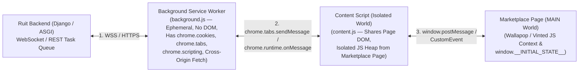

# Browsers, Automations (Playwright/CDP) & Chrome Extensions

> **Luis's Cheat Sheet Topic:** *"browsers, their automations, and chrome extensions"*

---

## 1. Browser Automation: Playwright & Chrome DevTools Protocol (CDP)

When an undocumented API requires browser-generated behavioral tokens, complex JS challenges, or has no clean direct endpoint, we use headless/headed browser automation.

### 1.1 Why Playwright Beats Legacy Selenium
- **Architecture:** Selenium uses the HTTP WebDriver protocol (Client $\leftrightarrow$ HTTP WebDriver binary $\leftrightarrow$ Browser), which is slow and chatty. **Playwright communicates directly with the browser over a single persistent WebSocket connection using the native Chrome DevTools Protocol (CDP).**
- **Browser Contexts (`browser.new_context()`):** Launching a full Chromium OS process takes ~1–2 seconds and ~150MB+ RAM. In Playwright, a single Chromium process can create dozens of isolated **BrowserContexts** in **milliseconds**—each with its own isolated cookies, `localStorage`, proxy, `User-Agent`, viewport, and timezone!

### 1.2 Hybrid Automation (The Senior Secret: Don't Click Every Button!)
Beginners automate browsers by clicking 15 DOM buttons (`page.click('#login')`, `page.fill(...)`), which is slow (30+ seconds), brittle when CSS classes change, and uses huge proxy bandwidth loading images/ads.  
**Senior Integration Engineers use Playwright in Hybrid Mode:**
1. **Block Heavy Assets (`page.route`):** Abort requests for images, fonts, video, and analytics trackers (`resource_type in {"image", "media", "font"}`)—cuts residential proxy bandwidth costs by **80–90%** and speeds up page loads 3x!
2. **Use the Browser Only to Mint Tokens / Intercept XHR:**
   - Load the page once in a persistent `BrowserContext` so the site's anti-bot JS (DataDome / Cloudflare Turnstile) executes and sets the valid clearance cookie (`cf_clearance` / `datadome`).
   - Then execute the actual API call directly inside the browser's authenticated TLS/cookie context via `page.evaluate("fetch(...)")` or `context.request.post(...)`—combining **100% browser fingerprint authenticity** with **API-level speed and stability**!

### 1.3 How Anti-Bot Systems Detect Headless Browsers (And How to Evade Them)
Anti-bot scripts probe the browser environment across 4 layers:
1. **JS Runtime Properties:** `navigator.webdriver === true` (dead giveaway of default Playwright/Puppeteer!), missing `window.chrome` object, inconsistent `navigator.plugins` or `navigator.languages`.
2. **Hardware & Graphics Fingerprinting:** Headless Linux servers in AWS/Hetzner lack a physical GPU, so **WebGL renderer strings** (`Google SwiftShader` / `Mesa OffScreen`) and **Canvas 2D font rendering** reveal a Linux server pretending to be a MacBook or iPhone!
3. **Network / IP Reputation:** Datacenter ASN IPs (AWS, GCP, DigitalOcean) are blocked or challenged immediately; requires **sticky residential or ISP proxies** geo-matched to the seller's country (e.g., Spanish residential IP + `Europe/Madrid` timezone + `es-ES` locale).
4. **Behavioral Biometrics:** Instant 0ms teleporting mouse clicks or 1000-char/ms keyboard paste events.

---

## 2. Chrome Extensions Architecture (Manifest V3) for Cross-Listing

**Why Chrome Extensions Are a Superpower in Recommerce (Ruit / Vendoo / Crosslist):**  
When a professional seller installs the **Ruit Chrome Extension** in their own desktop Chrome browser:
- The seller is **already logged into Vinted, Wallapop, Depop, Facebook Marketplace, and Poshmark** in their real browser!
- Every request made from the seller's Chrome Extension automatically uses the seller's **real residential IP address**, **real hardware GPU/TLS fingerprint**, and **real authenticated browser cookies**—completely avoiding datacenter proxy costs and anti-bot bans!

### 2.1 Manifest V3 (MV3) Architecture & Execution Contexts
You built a **top-10 VS Code extension with 630K+ installs (`Dadroit JSON Generator`)**, so you already understand extension sandboxes and message passing. In Chrome **Manifest V3**, there are 3 isolated execution contexts:

1. **Background Service Worker (`service_worker` in `manifest.json`):**
   - **MV3 Peculiarity:** Unlike Manifest V2 persistent background pages, **MV3 Service Workers are ephemeral**—Chrome terminates them after ~30 seconds of inactivity!
   - **How to keep MV3 reliable:**
     - Never store state in global JS variables in the service worker; persist state in **`chrome.storage.local` or `chrome.storage.session`**.
     - Use **`chrome.alarms`** (or periodic WebSocket heartbeat pings every 20 seconds when actively syncing) to wake the service worker and poll/receive jobs from Ruit's backend.
   - **Privileged APIs:** With `host_permissions: ["*://*.vinted.es/*", "*://*.wallapop.com/*"]`, the service worker can read/sync session cookies via **`chrome.cookies.getAll()`**, modify headers (like `Origin` and `Referer`) via **`chrome.declarativeNetRequest`**, and make cross-origin `fetch()` calls.
2. **Content Scripts (`Isolated World`):**
   - Injected into the marketplace tab (`vinted.es`, `wallapop.com`).
   - **Peculiarity:** Content scripts share the **exact same DOM tree** as the web page, but run in an **Isolated JavaScript World**—meaning they cannot directly read `window.vintedAppState` variables defined by the page's scripts, and the marketplace's JS cannot detect variables inside the content script!
3. **Page `MAIN` World Script (`world: "MAIN"`):**
   - If you need to hook `window.fetch` or call an internal function inside the marketplace's own JS bundle, use `chrome.scripting.executeScript({ target: { tabId }, world: "MAIN", func: ... })` and communicate back to the Content Script via `window.postMessage`.

### 2.2 Two Ways Ruit Can Use a Chrome Extension
1. **Mode A — Session/Token Bridge (Cloud-Executed Sync):**
   - The extension silently captures the seller's fresh session cookies / bearer token from `chrome.cookies` when the seller opens their browser and syncs them securely to Ruit's backend, so Ruit's cloud Celery workers can run 24/7 background inventory syncs even when the seller's laptop is closed.
2. **Mode B — Client-Side Task Delegation (Browser-Executed Sync):**
   - For marketplaces with extreme anti-bot protection or zero public API (like Facebook Marketplace), Ruit's backend sends a `PublishJob` command over WebSocket to the extension's Service Worker, which executes the `fetch()` or background tab automation directly inside the seller's browser and reports the `external_listing_id` back to Ruit!
