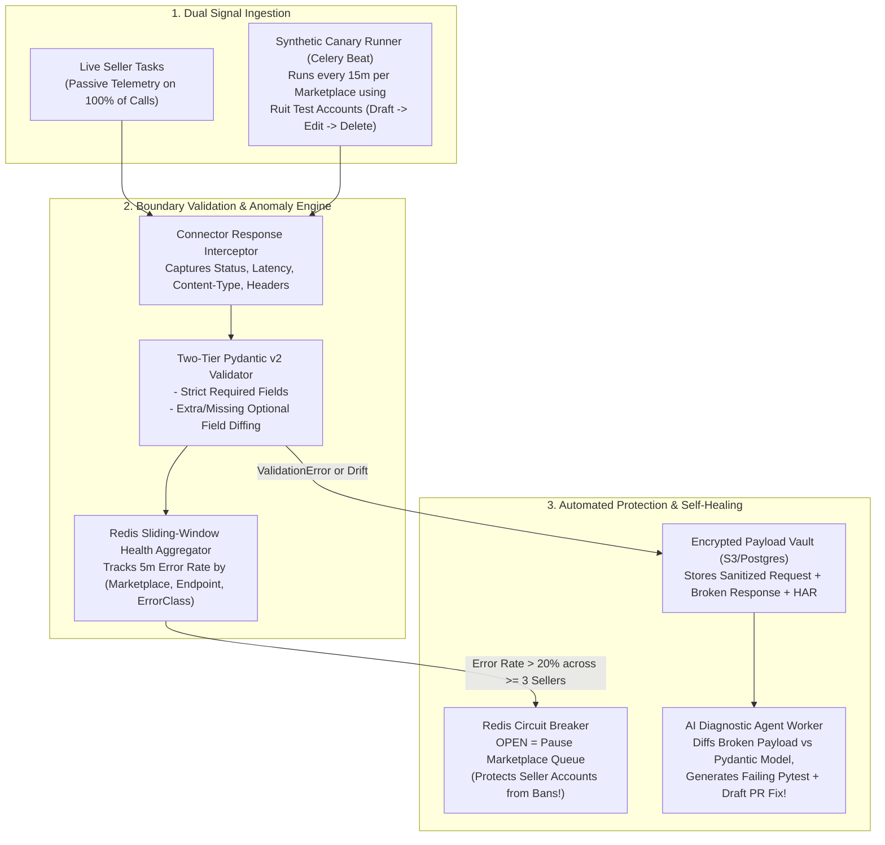

# Whiteboard Challenge 1: Proactive Breakage Detection & Self-Healing Integrations

> **Why This Challenge Is #1:** Ruit's roadmap is expanding from Wallapop, Vinted, and eBay to 10+ new marketplaces (Facebook Marketplace, Etsy, Poshmark, Mercari, Whatnot, Grailed, Depop, Vestiaire Collective, Amazon, TikTok Shop) where many connectors rely on reverse-engineered APIs. Their core engineering promise is:  
> ***"Catch each breakage before a seller does... every integration will warn us it broke before a seller notices."***

---

## 1. Clarifying Requirements & Failure Taxonomy (First 5 Minutes)

How does a marketplace integration actually "break" in the real world? Classify breakages into **4 distinct signals**:
1. **Schema / Contract Drift:** Marketplace renames/removes a JSON key, changes a field from `int` to `str`, or changes a GraphQL `persistedQuery` hash.
2. **Auth / Session Flow Change:** Marketplace changes token expiration, adds a new required header (`X-Client-Signature`), or invalidates refresh tokens faster.
3. **Anti-Bot / WAF Escalation:** Cloudflare/DataDome updates its TLS/JA4 rules or blocks a residential proxy subnet (spike in `403 Forbidden`, CAPTCHA HTML pages instead of JSON).
4. **Silent Business Logic Failure:** HTTP returns `200 OK`, but the listing is silently shadow-banned, stuck in "draft", or missing photos.

---

## 2. Whiteboard Architecture Diagram



---

## 3. Core Database & Redis State Design

### 3.1 Redis Sliding-Window Health & Circuit Breaker Keys
Why is checking *"Did >= 3 distinct sellers fail with the same error in 5 minutes?"* critical?
- If **1 single seller** gets a `401`/`403`, that seller's password/cookie expired (Pause *only* that seller).
- If **5 different sellers** across different proxies get `403` or `ValidationError` on `POST /items` within 3 minutes, **the marketplace changed or blocked our connector globally!**
  - Key 1: `cb:state:{marketplace}:{operation}` $\rightarrow$ `CLOSED` | `OPEN` | `HALF_OPEN`
  - Key 2: `health:errors:{marketplace}:{operation}:{5m_bucket}` $\rightarrow$ Redis Hash / HyperLogLog counting total calls, failures, and **distinct affected `seller_id`s**.

### 3.2 PostgreSQL Schema for Breakage Incidents
```sql
CREATE TABLE integration_breakage_incidents (
    id BIGSERIAL PRIMARY KEY,
    marketplace VARCHAR(32) NOT NULL,
    operation VARCHAR(64) NOT NULL,           -- e.g. 'publish_listing', 'delist_item'
    severity VARCHAR(16) NOT NULL,            -- 'SOFT_DRIFT' | 'HARD_BREAKAGE' | 'WAF_BLOCK'
    signature_hash VARCHAR(64) NOT NULL,      -- Deduplicates identical Pydantic/HTTP errors
    affected_sellers_count INT DEFAULT 1,
    sample_request_Meta JSONB NOT NULL,       -- Method, URL, sanitized header keys
    sample_response_body JSONB,               -- Sanitized raw payload that failed validation
    pydantic_error_details JSONB,             -- Exact field paths & expected vs actual types
    status VARCHAR(24) DEFAULT 'OPEN',        -- 'OPEN' | 'AUTO_PR_CREATED' | 'RESOLVED'
    created_at TIMESTAMPTZ DEFAULT NOW(),
    UNIQUE (marketplace, operation, signature_hash, status)
);
```

---

## 4. Deep Dive: How AI-Assisted Self-Healing Works (Your Secret Weapon)

Explain how Ruit can leverage its AI-agent culture to cut integration repair time from hours to **5 minutes**:
1. **Detection:** Canary probe or live call hits an `UpstreamContractBreakageError` (e.g., Depop changed `price_amount: "15.00"` to `pricing: {"total": 1500, "currency": "EUR"}`).
2. **Circuit Breaker Trips:** The `depop_publish` Celery queue pauses automatically so queued seller tasks wait safely instead of failing.
3. **Automated Reproduction:** A background diagnostic agent receives:
   - The current `DepopListingResponse` Pydantic model file.
   - The sanitized failing JSON payload from `integration_breakage_incidents`.
4. **Agent Fix + Verification Loop:** The agent writes a new `pytest` test case with the captured payload, updates the Pydantic `@field_validator` / alias to support the new structure, runs `pytest` + `ruff` + `mypy`, and posts a **1-click Draft PR + Slack alert** to the engineering channel!

