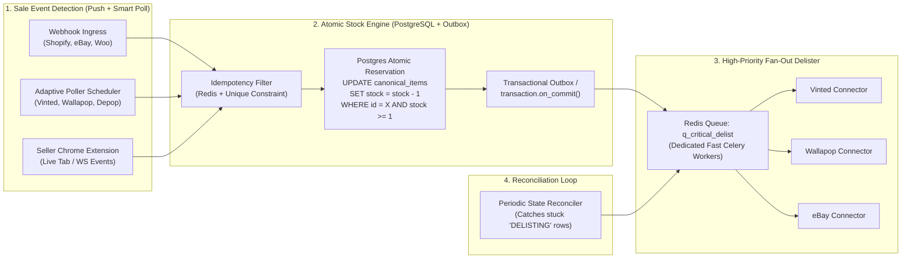

# Whiteboard Challenge 2: Multi-Marketplace Real-Time Inventory Sync & Double-Sell Prevention

> **Why This Challenge Is Core to Ruit:** Ruit's #1 value proposition to professional second-hand stores is: *"List an item once on Wallapop, Vinted, eBay, Depop, Vestiaire, and Shopify; the instant it sells on one channel, Ruit automatically delists or decrements stock on all other channels so you never suffer a double-sell penalty."*

---

## 1. Clarifying Requirements & Constraints (First 5 Minutes)

- **Unique vs Multi-Quantity Items:** Second-hand items usually have `quantity = 1` (highest double-sell risk!), though professional vintage wholesalers may have `quantity = N`.
- **Heterogeneous Sale Detection (Push vs Pull):**
  - **Tier A (Webhooks / Push):** Shopify, WooCommerce, eBay Platform Notifications push sale events in **1–3 seconds**.
  - **Tier B (Polling / Pull / Email / Extension):** Wallapop, Vinted, Depop often lack public seller webhooks—requiring **smart adaptive polling** (or notification/inbox/WebSocket listeners).
- **Target Delist SLA:** Once Ruit detects a sale, delisting across all other marketplaces must start within **< 2 seconds** and complete within **< 10 seconds**.

---

## 2. Whiteboard Architecture Diagram



---

## 3. Data Model & State Machine (Draw This on the Board!)

Separate the **Canonical Item** (Ruit's source of truth) from each **Marketplace Listing** (per-channel state):

```sql
CREATE TABLE canonical_items (
    id BIGSERIAL PRIMARY KEY,
    seller_id BIGINT NOT NULL,
    sku VARCHAR(64) NOT NULL,
    quantity_available INT NOT NULL DEFAULT 1 CHECK (quantity_available >= 0),
    status VARCHAR(24) NOT NULL DEFAULT 'ACTIVE', -- 'ACTIVE' | 'RESERVED' | 'SOLD_OUT'
    version INT NOT NULL DEFAULT 1,
    updated_at TIMESTAMPTZ NOT NULL DEFAULT NOW()
);

CREATE TABLE marketplace_listings (
    id BIGSERIAL PRIMARY KEY,
    canonical_item_id BIGINT NOT NULL REFERENCES canonical_items(id),
    marketplace VARCHAR(32) NOT NULL,             -- 'vinted', 'wallapop', 'ebay'
    external_listing_id VARCHAR(128) NOT NULL,
    desired_state VARCHAR(24) NOT NULL,           -- 'PUBLISHED' | 'DELISTED'
    actual_state VARCHAR(24) NOT NULL,            -- 'PUBLISHED' | 'SYNCING' | 'DELISTING' | 'DELISTED' | 'ERROR'
    last_synced_version INT NOT NULL DEFAULT 0,
    retry_count INT NOT NULL DEFAULT 0,
    UNIQUE (marketplace, external_listing_id)
);
```

### Why `desired_state` vs `actual_state` (Kubernetes-Style Declarative State) Is Genius:
Instead of firing a fire-and-forget task `"delist item 42"` that can get lost, your database transaction sets **`desired_state = 'DELISTED'`** on all sibling `marketplace_listings` rows while their `actual_state` is still `'PUBLISHED'`.
- Fast Celery workers immediately attempt to transition `actual_state` $\rightarrow$ `'DELISTED'`.
- If a worker crashes or eBay is down (`503`), a **Reconciler Cron (`every 60s`)** simply queries `WHERE desired_state != actual_state` and re-drives the convergence! **Zero lost delists, ever!**

---

## 4. Solving the 3 Hardest Engineering Challenges

### 4.1 Race Condition: Item Sells on Vinted and Wallapop 200ms Apart
How do we handle simultaneous sale events?
```sql
UPDATE canonical_items
SET quantity_available = quantity_available - 1,
    status = CASE WHEN quantity_available - 1 = 0 THEN 'SOLD_OUT' ELSE status END,
    version = version + 1
WHERE id = :item_id AND quantity_available >= 1
RETURNING id, quantity_available, version;
```
- **Worker 1 (Vinted sale):** `UPDATE` matches 1 row (`quantity_available` becomes `0`) $\rightarrow$ commits & triggers immediate delisting on Wallapop and eBay.
- **Worker 2 (Wallapop sale 200ms later):** `UPDATE` matches **0 rows** (`quantity_available` is already `0`!) $\rightarrow$ Ruit immediately detects a **Double-Sell Conflict**, marks the Wallapop order as `DOUBLE_SELL_ALERT`, and notifies the seller instantly via WebSocket/Push so they can cancel the second order before shipping!

### 4.2 Smart Tiered Polling for Marketplaces Without Webhooks
If you have 2,000 sellers on Vinted/Wallapop and no public webhooks, polling every single item (`5,000,000 items`) every 30 seconds would require `166,000 req/sec` (impossible and instant IP ban!).
**How to Poll 100x Smarter:**
1. **Poll Seller-Level Orders / Notifications Endpoint, NOT Individual Items:** Calling `GET /api/v2/my_orders?status=sold&page=1` or `/notifications` (1 request per active seller!) tells you *all* recent sales for that seller in a single HTTP call!
2. **Activity-Tiered Polling Cadence:**
   - **Hot Sellers** (currently active in app or high sales velocity): Poll `/notifications` or `/orders` every **30–60 seconds**.
   - **Warm Sellers:** Every **3–5 minutes**.
   - **Cold / Offline Sellers:** Every **15–30 minutes**.
3. **Email / Push Notification Ingestion Bridge (Bonus Trick!):** Marketplaces send an instant email (`"¡Has vendido un producto en Wallapop!"` / `"New sale on Vinted"`) within 2 seconds of a sale. Giving sellers an optional auto-forwarding address (`seller-xyz@inbound.ruit.es` via AWS SES / Postmark inbound webhook) gives Ruit **2-second push webhooks** for marketplaces that don't have an API!

