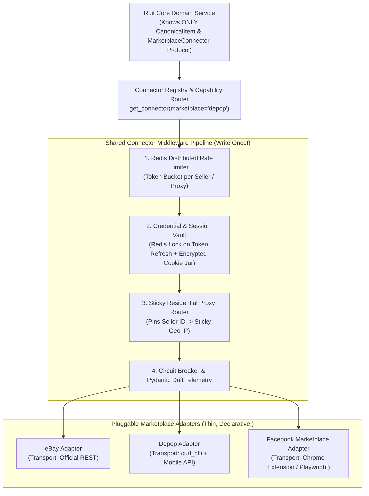

# Whiteboard Challenge 3: Plug-and-Play Marketplace Connector Engine (Scaling from 3 to 15+ Marketplaces)

> **Why This Challenge Is Core to Ruit:** Ruit currently supports Wallapop, Vinted, eBay, etc., and is hiring two engineers to add **10+ new marketplaces** over the next year (Facebook Marketplace, Etsy, Poshmark, Mercari, Whatnot, Grailed, Depop, Vestiaire Collective, Amazon, TikTok Shop).  
> If adding each new marketplace requires touching core Django views, Celery tasks, and DB tables, velocity grinds to a halt. How do we architect a **Unified Connector Engine** where adding a new marketplace takes days instead of months?

---

## 1. Clarifying Requirements & Marketplace Heterogeneity

Across 15 marketplaces, what varies vs what stays constant?
- **What stays constant (Core Domain):** Every marketplace has *Authentication*, *Image Upload*, *Category/Attribute Taxonomy*, *Publish Listing*, *Update Price/Stock*, *Delist/Delete*, and *Fetch Orders/Sales*.
- **What varies wildly (Connector Specifics):**
  - **Transport:** Official REST/GraphQL (`httpx`), TLS-impersonated private API (`curl_cffi`), Headless Browser (`Playwright`), or Client Chrome Extension (`WebSocket RPC`).
  - **Auth Lifecycle:** OAuth2 Refresh Tokens vs Cookie Jars + CSRF vs Request HMAC Signatures.
  - **Rate Limits & Quotas:** Per-seller token buckets vs per-IP limits.
  - **Upload Flow:** Multipart POST vs 3-step pre-signed S3 upload vs image URL ingestion.

---

## 2. Whiteboard Architecture Diagram



---

## 3. The Core Design Pattern: Capabilities + `typing.Protocol` + Shared Middleware

Instead of `if marketplace == "vinted": ... elif marketplace == "depop": ...` scattered across the codebase, every marketplace implements a strict **Python `Protocol`** and declares its **`ConnectorCapabilities`**:

```python
from dataclasses import dataclass
from typing import Protocol


@dataclass(frozen=True)
class ConnectorCapabilities:
    supports_native_webhooks: bool = False
    supports_quantity_gt_one: bool = False
    supports_in_place_price_edit: bool = True
    requires_browser_extension: bool = False
    rate_limit_requests_per_min: int = 30


class MarketplaceAdapter(Protocol):
    slug: str
    capabilities: ConnectorCapabilities

    async def validate_session(self, ctx: SellerSessionContext) -> bool: ...
    async def upload_media(self, ctx: SellerSessionContext, image_urls: list[str]) -> list[str]: ...
    async def publish_item(self, ctx: SellerSessionContext, item: CanonicalListingDTO) -> PublishReceipt: ...
    async def update_listing(self, ctx: SellerSessionContext, ext_id: str, patch: ListingPatchDTO) -> bool: ...
    async def delist_item(self, ctx: SellerSessionContext, ext_id: str) -> bool: ...
    async def fetch_recent_sales(self, ctx: SellerSessionContext, since_cursor: str | None) -> SalesPageDTO: ...
```

### Why Declarative `ConnectorCapabilities` Is So Powerful:
- Some second-hand marketplaces allow editing a price in-place (`PATCH /items/123`), while others block price increases or require delisting and re-creating.
- When `capabilities.supports_in_place_price_edit == False`, the **Core Orchestrator** automatically knows to execute a `delist + re-publish` workflow without putting custom spaghetti logic inside the Django view!

---

## 4. Shared Infrastructure Services (So New Connectors Are < 300 Lines of Code)

To make building a new marketplace connector (say, **Grailed** or **Poshmark**) take 2–3 days:
1. **Sticky Session & Proxy Manager:**
   - If Seller #42 in Madrid connects their Vinted and Depop accounts, Ruit assigns Seller #42 a **deterministic sticky residential proxy session in Spain (`es-mad-sticky-42`)** and persists their encrypted cookies/tokens in Postgres + Redis.
   - Using the same IP subnet and `User-Agent`/`Sec-Ch-Ua` profile across calls prevents *"Suspicious login from new device/location"* security lockouts!
2. **Contract-Driven Replay Harness (VCR / HAR Cassette Testing):**
   - Engineers record 1 real session (`login`, `upload_media`, `publish`, `delist`) into sanitized JSON cassettes.
   - CI runs `pytest` against those cassettes in 100ms, and a scheduled nightly canary runs the exact same adapter methods against a live Ruit test account.
