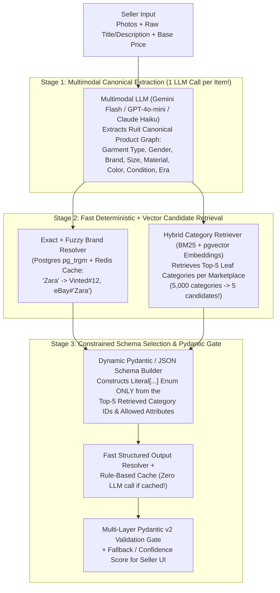

# Whiteboard Challenge 4: AI-Powered Catalog Normalization & Cross-Marketplace Category/Attribute Mapping

> **Why This Challenge Is Your Sweet Spot:** At **QueryLaw / TreeScribe**, you architected an AI system transforming complex European statutes into machine-readable decision graphs with **95%+ accuracy using dynamic context, structured outputs, and multi-layer JSON Schema (AJV) validation**.  
> At Ruit, professional sellers upload a second-hand item once (4 photos + a short title like *"Chaqueta cuero Zara talla M negra muy buen estado"*), and Ruit must automatically map it to **10+ completely different marketplace category trees and required attribute schemas**!

---

## 1. The Problem: Why Cross-Marketplace Taxonomy Mapping Is Hard

When publishing a women's black Zara leather biker jacket (Size M):
- **Vinted** requires: `catalog_id: 1204` (`Mujer > Ropa > Abrigos y cazadoras > Cazadoras > Cazadoras de cuero`), `brand_id: 12` (`Zara`), `size_id: 208` (`M / 38`), `color_ids: [1]` (`Negro`), `status_id: 2` (`Muy bueno`).
- **Wallapop** requires: `category_id: 12465`, `subcategory: "leather_jackets"`, `condition: "as_good_as_new"`, `brand: "Zara"`, `size: "M"`.
- **eBay** requires: `CategoryID: 63862`, `ItemSpecifics: {"Outer Shell Material": ["Leather"], "Style": ["Motorcycle Jacket"], "Size Type": ["Regular"], "Department": ["Women"]}`.

**Why Naive Prompting Fails:**
1. Vinted and eBay have **5,000+ leaf categories** and **100,000+ brand IDs**—you cannot stuff 5,000 categories into an LLM prompt window on every item (too slow, $0.10+/item token cost, and high hallucination rate of invalid IDs!).
2. If the LLM hallucinates `size_id: 99999` or an invalid enum string, the marketplace API rejects the listing with `400 Bad Request`.

---

## 2. Whiteboard Architecture: Hybrid Retrieval + Constrained LLM + Deterministic Validation

---

## 3. The 4 Engineering Breakthroughs in This Design (Directly From Your QueryLaw Playbook!)

### 3.1 Extract Once to a Canonical Ontology, Then Map $1 \rightarrow N$
Never call an LLM 10 separate times from scratch for 10 marketplaces!
1. **Step 1 (Multimodal Extraction):** Run **1 fast multimodal call** on the product photos + seller text to produce a **Canonical Ruit Product Record** (validated by Pydantic) + clean SEO-optimized titles/descriptions.
2. **Step 2 (Deterministic Lookup Cache First):** Once you know `CanonicalCategory = "Women's Leather Biker Jacket"`, `Size = "EU M"`, `Condition = "Very Good"`, **95% of category/size/color mappings to Vinted, Wallapop, and eBay can be served from a deterministic PostgreSQL/Redis mapping table in < 2ms at €0.00 token cost!**

### 3.2 Narrowing 5,000 Categories to Top-5 Candidates (`pgvector` + Hierarchy Walk)
When an item hits an uncached/ambiguous category or requires marketplace-specific `ItemSpecifics` (like eBay's required `Outer Shell Material` or `Sleeve Length` that depends on the chosen `CategoryID`):
1. Embed each marketplace's full category path (`"Women > Clothing > Coats & Jackets > Leather Jackets"`) in PostgreSQL using **`pgvector`** + full-text search.
2. Retrieve the **Top-5 candidate leaf categories** in 5ms.
3. Fetch the **marketplace-specific required attribute schema** for those Top-5 categories from Ruit's synced taxonomy table.

### 3.3 Dynamic Constrained Structured Outputs (Zero Hallucinated IDs!)
Just like you did at QueryLaw with dynamic context + AJV schemas:
- Dynamically construct a **Pydantic model / JSON Schema** at runtime where `category_id` is constrained to `Literal[1204, 1205, 1209, 1212, 1215]` (the 5 retrieved IDs) and `material_id` is constrained to the exact valid enum IDs allowed by that category!
- Pass this schema to the LLM's **Structured Outputs** mode, followed by a strict **Pydantic v2 cross-field validator** verifying that every selected attribute ID actually belongs to the chosen `category_id`.

### 3.4 Human-in-the-Loop Feedback Flywheel
- Each attribute gets a confidence score. If confidence is `< 0.80` on a mandatory field, highlight just that 1 dropdown in the Ruit UI for the seller.
- Whenever a seller manually corrects a category mapping (`Canonical X` $\rightarrow$ `Vinted Category Y`), record that correction as a weighted vote in PostgreSQL—turning seller edits into a **self-improving deterministic lookup table**!

