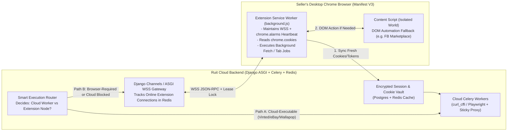

# Whiteboard Challenge 5: Hybrid Chrome Extension + Cloud Worker Execution Architecture

> **Why This Challenge Is Crucial for New Marketplaces:** As Ruit expands to **Facebook Marketplace, Poshmark, Depop, Whatnot, and Vinted**, some actions work best from Ruit's 24/7 cloud servers (inventory polling, webhook handling), while other actions (bypassing strict residential IP / Cloudflare Turnstile checks, syncing fresh login cookies, or posting to browser-only marketplaces like Facebook Marketplace) work best inside the **seller's Chrome Extension**.  
> How do we design a seamless **Hybrid Cloud + Chrome Extension Execution Engine**?

---

## 1. Clarifying Requirements & Constraints (First 5 Minutes)

- **The Core Asymmetry:**
  - **Cloud Workers (Celery):** Always online 24/7, high throughput, deterministic, **but** run on datacenter/proxy IPs and can lose session cookies when anti-bot challenges trigger.
  - **Seller's Chrome Extension (Manifest V3):** Has the seller's real residential IP, real hardware TLS/WebGL fingerprint, and live logged-in browser sessions, **but** is only online when the seller's laptop is open and Chrome is running!
- **Design Goal:** Use the Chrome Extension as **both** (1) a **Session/Cookie Sync Bridge** that keeps Cloud Workers authenticated 24/7, and (2) an **On-Demand Remote Execution Node (RPC Worker)** for browser-only marketplaces!

---

## 2. Whiteboard Architecture Diagram

---

## 3. Deep Dive: The 3 Core Subsystems

### 3.1 Subsystem 1: Automatic Cookie & Token Harvesting Bridge
Whenever the seller opens Chrome or visits a connected marketplace (`vinted.es`, `wallapop.com`, `depop.com`):
1. The Extension's Service Worker listens to `chrome.cookies.onChanged` (or runs a periodic `chrome.alarms` check every 15 minutes).
2. It extracts the fresh authentication cookies (`access_token_web`, `_vinted_fr_session`, `cf_clearance`, `datadome`), along with the seller's exact `navigator.userAgent` and `Sec-Ch-Ua` headers.
3. It encrypts and pushes this **Session Bundle** to Ruit's Cloud Vault (`POST /api/v1/extension/session-sync`).
4. **Result:** Ruit's 24/7 Cloud Celery workers can now impersonate the seller's exact browser headers and fresh clearance cookies via `curl_cffi` even after the seller closes their laptop!

### 3.2 Subsystem 2: WebSocket Job Leasing Protocol (Dealing with Ephemeral MV3 Service Workers)
Because Chrome Manifest V3 terminates idle Service Workers after 30 seconds, how do we reliably execute a multi-step publish job on the extension without losing tasks if the seller closes their laptop mid-job?

Use a **Pull-Based Lease Protocol with Lease Expiration**:
1. **Job Queuing:** Ruit Cloud creates a `BrowserJob` row in Postgres (`status = 'PENDING'`, `idempotency_key = '...'`).
2. **Wakeup Notification:** If the seller's extension has an active WebSocket connection in Redis (`ext:online:{seller_id}`), Django Channels pushes a lightweight `{"type": "JOBS_AVAILABLE"}` frame (and if idle, the extension wakes up every 1 minute via `chrome.alarms` to check).
3. **Atomic Job Lease (`LEASED`):**
   - The extension calls `POST /api/v1/extension/jobs/claim`.
   - Ruit locks the job (`SELECT ... FOR UPDATE SKIP LOCKED`) and sets `status = 'LEASED'`, `lease_expires_at = NOW() + INTERVAL '60 seconds'`.
   - While executing (e.g., uploading 4 images to Facebook Marketplace), the extension sends a `heartbeat` every 15s to extend the lease.
4. **Completion or Lease Recovery:**
   - On success, the extension sends `POST /api/v1/extension/jobs/{id}/complete` with `external_listing_id`.
   - If the seller's laptop battery dies mid-upload, `lease_expires_at` passes, and Ruit's cloud reconciler resets the job to `PENDING` (or falls back to a cloud Playwright worker / notifies the seller in the UI).

### 3.3 Subsystem 3: Smart Fallback Routing (Cloud First $\rightarrow$ Extension Fallback)
For marketplaces that *usually* work from the cloud via `curl_cffi` + residential proxy, the **Smart Execution Router** tries the **Cloud Worker first** (instant, works 24/7).  
If the Cloud Worker encounters a sudden Cloudflare Turnstile / DataDome `403` challenge that requires a real browser, instead of failing the seller's task, it **seamlessly re-routes the task to the seller's Chrome Extension queue** next time their browser is online!
